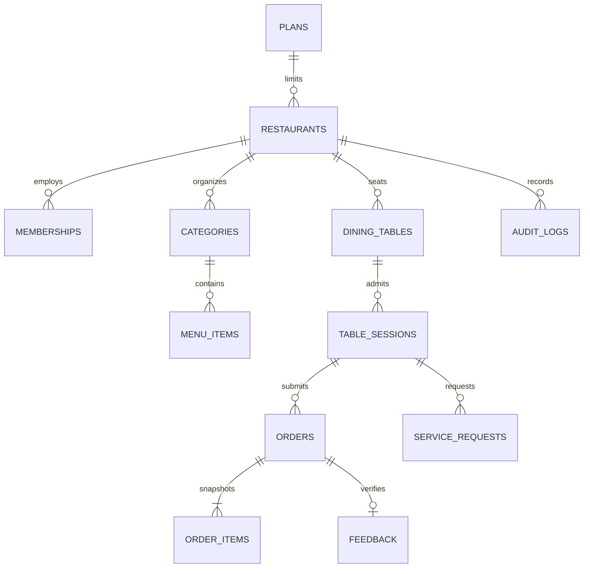

# Architecture

## Application boundaries

Next.js App Router renders the shell. Client components use a single Supabase browser client with the public publishable key. Supabase Auth issues identity tokens. PostgreSQL RLS governs every application table, including platform metadata. Security-definer RPCs enforce business permissions and transitions with an empty search path and fully qualified relation names. The browser never sets its own role, tenant, authoritative price, or status through direct table writes.

The browser's role checks only choose which controls to display. PostgreSQL checks the actor again on every mutation. No service-role key is required by this application.

## Relationships

Every tenant relation carries a restaurant ID. Composite foreign keys prevent cross-tenant parent/child links. Membership checks use a stable security-definer helper to avoid recursive RLS evaluation. An authenticated guest sees a menu only after exchanging an unguessable table token for a session; sessions expire after twelve hours. Guests see only their own orders, feedback and service requests. Staff see operational data within their restaurant. Platform admins can manage restaurant status and plans but do not automatically get access to guest orders or menus.

`platform_admins` cannot be edited through the browser. Bootstrap an authorized operator by inserting their Auth user ID through the Supabase SQL editor as a database administrator. Never expose this bootstrap action as a client RPC.

## Ordering transactions

- `place_order` checks session ownership, expiry, table state, restaurant state, item availability and quantity. Menu prices/names are copied from the database. Any invalid line rolls back the entire ticket.
- `(customer_id, idempotency_key)` is unique. A transaction-scoped advisory lock serializes identical submission keys, including simultaneous retries. A committed retry returns its original ticket ID, even after the table session expires.
- The client persists both the pending key and exact payload. Network uncertainty keeps the payload locked for a safe retry. Definitive SQL validation errors allow correcting the cart. Credentials and service secrets are never stored in this cart data.
- `transition_order` locks the ticket row, verifies the expected status, role, and legal next status, then updates timestamps and audit history. Null arguments are rejected.
- `edit_order_item` acquires the same ticket lock. This serializes preparation and edits. Cancelling every line cancels the ticket. Started tickets cannot be edited; add-ons use a new ticket.
- Staff actions require fresh database authorization. Owners/admins can prepare and serve; cooks can prepare/ready; waiters can serve. No role may skip directly from placed to served.

The MVP treats every submission as one preparation ticket. All lines on that ticket lock together. Further item-level preparation splitting can be introduced without rewriting existing ticket history.

## Realtime and recovery

Orders, items, service requests and menu items are in the Supabase Realtime publication. PostgreSQL Changes delivery is filtered by row visibility. The client refetches authorized snapshots after events, on reconnect, and every 30 seconds to recover missed events. Separate tab/profile/device sessions are required to exercise guest and staff identities simultaneously. Offline actions are blocked; carts survive reloads. No offline automatic order submission is performed.

Recent history and reporting use the latest 200 tickets. Active tickets are loaded separately using cursor pagination and merged with that history, so older active tickets remain visible. Metrics are labeled as the limited recent-ticket window, not complete accounting reports.

## Media, plans and personal data

Restaurant media is a public bucket for menu images/video, not private customer data. Upload/delete policies require owner/admin membership and a tenant-prefixed object path. MIME types and file size are constrained. Menus may also use externally hosted URLs; the no-referrer response policy prevents table tokens leaking in referral headers.

Plans enforce table, staff and menu limits inside serialized provisioning RPCs. Subscription payment processing is deliberately absent. Platform administrators can switch plans or pause incoming orders.

The database stores Auth user IDs, order content and optional feedback. Free-text instructions can contain sensitive information. Audit logs exclude note bodies. A documented retention/export/deletion process and legal review are needed before launch; the code does not assert GDPR compliance. Table tokens should be rotated between sessions in a hardened deployment. Auth deletion currently requires application-data cleanup first because historical order references are retained.
